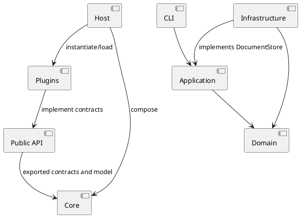

# Phase 2 作业索引与 CLI 设计

## 1. 范围、基线与运行

当前 phase2-complete / p2-complete 同时交付 [VSCode 实践](vscode.md)、本页的插件式 CLI 和 [DSH 插件](dsh.md)。下文保留 CLI 架构与验收说明。沿用原仓库 main 的 `bacf584`，保留此前 Command 重构与缺陷修复；作业要求的兼容性对照仍是 `final`。`p2` 仍是原 CLI 发布快照，后续两部分在 `p2-complete` 中提供；历史标签不重写。

启动方法见[根 README](../README.md)。默认启用四个可选插件包，`--builtin-only` 关闭它们；内置六类图形及全部 Phase 1 命令始终可用。`--config <file>` 选择配置装配，不先装默认可选插件，避免重复注册。`help` 来自实际注册的命令列表。

## 2. 模块变化与依赖

| 位置 | Phase 1 | Phase 2 |
|---|---|---|
| 图形构造 | ShapeFactory 内列出具体类型 | 接收 ShapeProvider 注册表；默认类型也通过插件注册 |
| 命令构造 | CommandFactory 内列出内置命令 | 只解析输入并查 CommandProvider；默认命令表移入独立包 |
| set | 单一属性规则 | 先查询 AttributeHandler，未命中保留原规则 |
| tree | 固定行文本 | 基础行不变，按注册顺序追加 TreeDecorator 标签 |
| 启动 | main 手工组合固定对象 | Host 选择 A/B；同一个注册事务处理全部插件 |
| undo | 受影响字段和位置的局部补偿 | 复用原机制；属性处理器可将多次写入合成一个历史单元 |

重构前后可直接渲染的 PlantUML 源文件：[Phase 1](architecture/phase1.puml)、[Phase 2](architecture/phase2.puml)。关键依赖为：



核心是 `src/domain`、`src/application`、`src/cli`、`src/infrastructure`、`src/api`。宿主是 `src/host` 与 `src/main.ts`。插件仅通过 `src/api/index.ts` 使用核心能力；目录适配器另使用 Node 文件系统 API。测试检查依赖方向、禁止核心导入插件、禁止核心枚举可选插件名称；各命令 execute/undo 仍只转发给接收者。

## 3. 四个扩展点清单

| 扩展点及定义 | 核心调用点 | 解决的变更问题 | 默认能力和失败契约 |
|---|---|---|---|
| ShapeProvider，`src/domain/ShapeProvider.ts` | `ShapeFactory.create/fromSvg`，分别由 EditReceiver 和 SvgCodec 使用 | 新图形创建与读回不再修改工厂类型表 | builtin-shapes 注册 rect/circle/ellipse/line/text/g；未知类型报错；provider 负责自己的构造与结构校验 |
| CommandProvider，`src/application/CommandProvider.ts` | `CommandFactory.parse` → `CommandTrigger` → `CommandExecutor` | 新命令不再改核心命令表 | builtin-commands 提供原命令；未加载的 stats/dir 报 unknown command；help 读取实时注册表 |
| TreeDecorator，`src/application/TreeDecorator.ts` | `ViewReceiver.decorate`，用于根行、子树首行及每个子行 | 新显示标签不改渲染器，也不侵入图形模型 | 无可选装饰器时输出逐字节不变；空字符串跳过，其他标签按顺序以一个空格拼接 |
| AttributeHandler，`src/application/AttributeHandler.ts` | `EditReceiver.set` → `AttributeTransaction` | 将特定图形的属性语义与通用 set 分离 | 零命中保留 Phase 1 白名单；唯一命中执行；多命中拒绝；部分失败整体补偿，不能转入默认处理 |

所有扩展实例有稳定 `name`；四种注册方法由 `PluginContext` 提供。插件是实现 `Plugin.activate` 的类实例。`ExtensionRegistry` 是唯一注册与校验入口，插件无需知道清单比较或历史栈内部结构。

## 4. 两种装配和清单

方式 A 位于唯一顶层文件 `src/host/CodePlugins.ts`：导入插件实例及其真实 package.json 清单，构造 `{plugin, manifest, options?}` 列表。Runtime 将列表交给加载器，再调用 Registry；没有直接绕过校验的 activate。

方式 B 由仓库根的 `plugins.config.json` 提供：

```json
{
  "plugins": [
    { "module": "./plugins/command-stats" },
    { "module": "./plugins/command-dir" },
    { "module": "./plugins/shape-box", "options": { "fill": "#4a90d9" } },
    { "module": "./plugins/tree-star" },
    { "module": "@svgframe/example", "enabled": false }
  ]
}
```

`options` 原样传给 activate；只有插件解释其中内容。上例的禁用项不会解析、导入或注册。数组顺序决定注册与标签顺序。空数组只启动内置能力。相对目录包读取其 package.json/main；相对文件路径也支持；已安装包名采用标准 Node ESM 的 node/import 解析条件。精确解析边界及依赖理由见[加载说明](plugin-loading.md)。

box 包清单声明 `shapes:["box"]`、`attributes:["box-attributes"]`、`decorators:["box-type-label"]`。激活时所有注册先进入暂存表，完成后按四类名称集合与清单比较，再一次提交。不同类别可同名，同一类别禁止重复。失败的插件整包撤销暂存，已成功的插件保留，继续加载下一项。

| 问题 | 一行错误前缀 |
|---|---|
| 顶层模块未找到 | `error: plugin not found: <module>` |
| 无默认导出 | `error: plugin has no default export: <module>` |
| 声明与实际贡献不同 | `error: plugin manifest mismatch: <name> (declared: …, registered: …)` |
| 模块求值、内部依赖或 activate 失败 | `error: plugin failed to activate: <name> (<reason>)` |
| 重复贡献 | `error: duplicate registration: <category>/<name>` |
| 配置语法或结构错误 | `error: invalid plugin config` |

加载器没有具体插件的导入或名称映射；包名、相对目录和选项都属于最外层装配知识。插件注册上下文完成后关闭，不能继续注册。

## 5. 编辑、复合图形和标签的关键契约

一次 `set`：定位 Shape → 纯查询全部 handler → 唯一匹配 → 在同一局部事务内调用 edit.set → 立即求值并验证反馈 → 成功入历史。每次写入先记录补偿，部分失败逆序恢复。事务完成或失败即关闭，异步 handler 被拒绝；undo 消息不会在历史迁移时执行插件回调。具体决定与限制见 [ADR 001](adr/001-attribute-transactions.md)。

box 使用 Group 的通用容器协议，核心没有 box 分支。内部必要子部件是 `<id>-rect` 和 `<id>-label`；整个新子树先校验 ID，再插入。必要部件不能被普通 CLI 命令拆走；box 本身可移动、嵌套、分组、删除和撤销。整体 ungroup 拒绝。保存为 `g data-kind="box"`，未装插件时降级普通 g，有插件但结构损坏时拒绝整个读入。[ADR 002](adr/002-box-reconstruction.md) 说明取舍，[插件说明](../plugins/shape-box/README.md) 说明参数。

`modified-star` 按当前内容与最近成功 read/save 的基准比较，新 init 立即标星。undo 回到保存内容则消星；变化向祖先传播；删除和排序通过子列表比较体现。成功 save/read 建立独立基准快照，失败不替换；快照只供比较，不进入编辑历史。插件必须只读访问模型及保存基准。默认标签顺序为 `(box) *`，规则间不互相引用。详见 [ADR 003](adr/003-dirty-and-label-order.md) 与 [ADR 004](adr/004-atomic-plugin-registration.md)。

## 6. dir 的 Adapter 模式

| 角色 | 对应代码 | 职责 |
|---|---|---|
| Client | DirectoryReceiver | 只按自身需求读取目录项、排序、格式化和归一化错误 |
| Target | DirectoryReader | 定义 `read(path)`，返回简单的 name/kind 数据 |
| Adaptee | Node `fs/promises.readdir` 与 Dirent | 提供平台文件系统 API |
| Adapter | NodeDirectoryAdapter | 调用 readdir，将 Dirent 转为 Target 的目录项 |

DirProvider 注入目录访问接口和 cwd 来源；DirCommand 只转发。测试替身不需要磁盘，真实适配器测试使用临时目录。`dir` 读取 CLI 进程的当前目录，read/save 不改变 cwd；不需要文档，不进入历史，不改变 dirty。目录、普通文件分别排序，包含隐藏项；特殊项额外分组为 `[LINK]`、`[OTHER]`，不追踪链接。空目录、失败消息及排序细节见 [dir 说明](../plugins/command-dir/README.md)。

## 7. 与课件原则的对应

| 课件关注点 | 本次落实 | 避免的问题 |
|---|---|---|
| 深模块、把复杂性下移 | Registry 的一次 activate 隐藏暂存、重复检查、清单比较和回滚；AttributeEdit 隐藏补偿记录 | 每个插件重复实现同一套框架规则 |
| 信息隐藏，以设计决策划分模块 | box 独占内部 id 与属性传播知识；Codec 独占 XML；Adapter 独占 Dirent 转换 | 读写双方或多个命令同时理解插件内部结构 |
| 稍微通用、避免 Classitis | 只为现有四个变化轴建立接口；保留原有简单编辑模型 | 为未知需求增加服务定位器、事件总线、万能插件容器 |
| Strategy：替换行为 | ShapeProvider 与 AttributeHandler 提供可选择的构造／属性策略；调用者面向契约 | 用核心 if/switch 枚举插件名字 |
| Adapter：从客户端需要定义接口 | DirectoryReader 先表达目录命令所需能力，NodeDirectoryAdapter 翻译外部 API | 文件系统对象泄露给命令、单测必须访问真实磁盘 |
| Decorator：叠加展示职责、规则与内容分离 | 两个独立标签按顺序增加行尾信息，基础内容不变；没有在 Shape 中存显示标志 | 每增加标签修改图形类或渲染器、标签互相感知 |
| Observer 的适用边界 | 当前采用内容查询，不增加通知关系 | 用事件集合代替内容差异，导致 undo 保存点语义和多个观察者更新时序更难保证 |
| Command：请求与执行者分离 | 保留薄命令、Receiver、Invoker、History；插件命令也经过同一执行器 | 命令自己编排业务或直接操作历史栈 |

树标签 API 是有序装饰规则组合，接近课件将标签规则与内容提供者分离的思路；本实现没有同接口递归包装的完整 GoF Decorator 类层级，因此不把接口名当作经典结构已经齐备的证明。Observer 课件并不意味着每个系统都必须加入 Observer；需要事件驱动 UI 时再引入。

依据为已提供的《设计原则（A Philosophy of Software Design）》及 Adapter、Decorator、Strategy、Observer 课件。重构评价以降低变更放大、认知负荷和隐含依赖为主；代码行数与圈复杂度作为辅助证据。增加加载校验及失败恢复会增加总代码量，本项目没有把“行数必然变少”当作完成标准。

## 8. 回溯、验证与边界

阶段记录见 [phase2-plan](phase2-plan.md)。box 的 A/B 是两个从同一基础分出的真实提交；[Git 证据](extension-proof.md) 记录差异并检查相关路径确实存在，避免因不存在路径而出现假空结果。`p2` 标记最终 CLI 快照。

```sh
npm run check
npm test
npm run verify
npm run verify:extensions
npm run metrics
```

测试包含原 Phase 1 全部回归、各插件独立上下文测试、属性部分失败及历史保持、所有加载失败与回滚、真实目录适配器、损坏 box 读回、dirty 状态与标签组合。回放比较不归一化空白：对照 final 的禁用插件基线、三组 A/B 会话的 stdout/stderr 及生成 SVG，逐字节一致。dir 在固定临时目录执行，日志位于目录外。

指标从 Git 中读取源码，用 TypeScript AST 计算同一口径的函数体与分支总量；按内核、装配处、插件拆分，排除依赖、构建产物和测试。首次框架报告与最终报告都在 [docs/metrics](../docs/metrics/README.md)，可从明确提交重新生成。

这仍是课程范围的 SVG 编辑器，并非完整 SVG/CSS 引擎。树标签当前采用直接内容比较，深链大树的最坏成本在插件 README 中说明。插件是受信任的进程内代码，事务不承诺隔离绕过公开写入口的任意副作用。CLI 本身不实现插件在线安装、热卸载或多人协同；VSCode 与 DSH 的独立宿主能力及其边界见各自文档。
