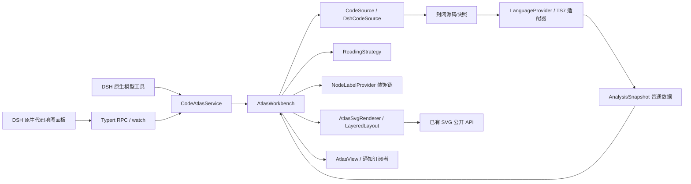

# Code Atlas 第一版设计与课程原则对照

## 目标与范围

将已有 SVG 编辑项目的公开图形能力用于真实源码阅读：扫描 DSH 会话工作区，生成有源码证据的结构地图，支持依赖 / 使用者视角和会话内已读标签。第一版专注 TS / JS 的静态结构，不生成完整调用图、不执行被扫描项目。

本设计依据仓库外的《课程设计原则与模式阅读笔记.md》整理的五份课件要点，并落实在以下具体模块中。设计模式服务于独立变化点；模式数量、类数量不作为完成程度的依据。

## 分层与数据流

| 模块 | 持有的知识与责任 |
| --- | --- |
| `host/DshCodeSource.ts` | DSH 文件服务、工作区边界、忽略规则、读取限额和内容哈希 |
| `analysis/TypeScriptLanguageProvider.ts`、`TypeScriptSourceFacts.ts` | TS7 项目、AST、符号解析及位置换算；输出普通 DTO |
| `core/AtlasWorkbench.ts` | 每个会话的分析事实、阅读状态、版本核验和原子发布 |
| `core/ReadingStrategies.ts`、`Labels.ts` | 阅读子图算法、独立显示职责 |
| `render/*` | 图布局及源码模型到已有 SVG API 的投影 |
| `host/CodeAtlasService.ts`、`typert.ts` | 真实 DSH 生命周期、RPC 线协议、取消与订阅流 |
| `client/*` | 原生侧栏 / 主面板、用户交互、同一服务状态的呈现 |

原生工具和 RPC 调用同一个 `CodeAtlasService` 及 `AtlasWorkbench`，不存在模型工具和面板各建一套分析状态的问题。工具从 `exec.agent.id` 取会话，服务从真实 `session.header.cwd` 取根目录；调用者不能传任意扫描根路径。

## 事实、状态和源码位置

`AnalysisSnapshot` 只保存节点、关系、诊断及版本；选择节点、方向、深度、公开 API 标签和已读集合属于独立的阅读状态。切换阅读视角不重新分析源码，切换标签不修改节点领域数据。

文件节点 ID 为 `file:<相对路径>`；符号 ID 由文件、种类和声明起始偏移构成，不拼入整份快照哈希。因此不相关文件的变化不会让所有 ID 失效；声明前插入文本仍可能改变其 ID。快照 ID 由排序后的路径和文件 SHA-256 得到。

`SourceLocation` 同时包含文件相对路径、文件哈希、UTF-16 起止偏移及从 1 开始的行列号。查看源码、标记已读前重新读取文件并核验哈希；不同版本返回 `STALE_SOURCE`，要求刷新。重新扫描只保留同一节点且对应文件内容未变的已读标记。

同会话扫描串行；关闭会话增加代次，旧任务不能在关闭后重新发布状态。新视图先完成策略、标签和渲染，再替换状态、通知订阅者；扩展失败不会留下半份新状态。已读和阅读设置只在会话内存中，尚无持久化。

## TS7 适配与分析语义

版本锁定为 TypeScript **7.0.2**，使用实际安装包的 `typescript/unstable/sync`、`unstable/fs`、`unstable/ast`。编译器 API 的不稳定性由分析层吸收；核心与界面不持有 Program、Checker、AST、远程句柄或编译器对象。快照 `dispose()` 与 API `close()` 在 `finally` 中执行。

传给编译器的虚拟文件系统只包含当前源码快照。缺失读取显式返回 `null`；TS7 的 `undefined` 会允许回退真实文件系统，所以此处不能省略。不存在的目录返回空结果，不能借由解析依赖读取工作区外文件。

分析器识别文件、类（含类表达式）、接口、函数（含赋值箭头函数）、方法和命名空间，保留嵌套父子关系。模块关系来自 import / re-export，类型关系来自 extends / implements；通过符号解析穿过别名和再导出，目标使用真实节点 ID。静态 `import("...")` 类型可参与解析；运行时 `import()` 保留未解析证据。声明合并导致目标不唯一、依赖缺失或外部目标时，关系明确为 `resolved: false`、无 `to`，不会捏造目标。

根内 `tsconfig`、配置继承、路径映射和 `.js` 到 `.ts` 的解析由 TS7 负责。快照含源码和所需根内配置，但不读取依赖目录或工作区外配置。损坏文件保留文件节点与语法诊断，跳过其符号和出向关系。它是受限结构分析，不提供完整语义诊断或运行时结论。

## 三个扩展契约

| 变化轴 | 契约 | 必须保持的语义 |
| --- | --- | --- |
| 语言分析 | `LanguageProvider.analyze(SourceSnapshot)` | 只消费给定内容，返回可序列化的 `AnalysisSnapshot`，节点 / 关系引用一致，保留证据和诊断，不暴露 SDK 对象 |
| 阅读算法 | `ReadingStrategy.select(snapshot, nodeId, depth)` | 只读事实，返回子图 ID；处理环、深度及数量上限。当前公开方向为 `dependencies` / `users`，不是任意字符串插件菜单 |
| 标签职责 | `LabelDecoratorFactory.wrap(NodeLabelProvider)` | 返回同接口对象，委托上游再增加显示职责，不改源码事实、关系或已读集合 |

`AtlasRegistry` 检查名称非空、同类名称唯一，并返回注销函数。内核不把可变 Workbench 暴露给扩展。现有装配选择 TS / JS provider；替换语言时应在装配层传入实现，注册一个新名称本身不会创建语言选择 UI。阅读方向的新公共取值还需同步更新线协议和界面契约，不能仅注册后声称完整接入。

## 四种模式的参与者与收益

| 模式 | 本版参与者 | 对应课件意图 |
| --- | --- | --- |
| Adapter | Client：Workbench；Target：`CodeSource` / `LanguageProvider`；Adapter：`DshCodeSource` / `TypeScriptLanguageProvider`；Adaptee：DSH FS / TS7 API | 把外部文件接口、AST 与符号查询转换为客户端需要的快照和事实接口，隐藏兼容性知识 |
| Strategy | Context：Workbench；Strategy：`ReadingStrategy`；ConcreteStrategy：`DependenciesFirst`、`UsersFirst` | 稳定的建视图流程委托可替换的图遍历步骤，运行时切换方向，无须重跑分析 |
| Decorator | Component：`NodeLabelProvider`；ConcreteComponent：`BasicNodeLabel`；ConcreteDecorator：`PublicApiLabel`、`ReadLabel`、`TestFileLabel` | 同接口、持有上游、委托后叠加职责；标签可组合，公开 API 标签可运行时撤销 |
| Observer | Subject：Workbench；Observer：`subscribe()` 回调 / 原生 `watch`；界面：Controller 的订阅者及地图 / 源码视图 | 一次状态变化通知多个呈现者；保存注销函数，界面卸载、会话关闭、插件卸载时释放 |

两种遍历算法分别沿出向边、入向边选择子图，真正改变阅读顺序和结果；仅改变按钮名称不算策略。标签包装者实现同一接口并持有内层对象，符合经典 Decorator 结构；普通字符串规则列表不能单独作为该结构的证明。

Observer 发布的是分析 / 阅读视图变化，不是文件系统自动监听。一个订阅者异常不影响其余订阅者。原生 watch 使用取消信号，慢消费者只保留最新视图，避免队列无限积压；会话和插件生命周期都会结束流。

## 独立标签插件的扩展验证

基线提交为 `7a5cfbf`。此后新增 `src/plugins/test-file-label.ts`：`TestFileLabel` 实现相同的 `NodeLabelProvider` 接口、持有内层 provider，先委托再追加 `[测试文件]`；工厂 `testFileLabel` 的注册名为 `test-file`。识别 `.test` / `.spec` 的 TS / JS 后缀或完整 `__tests__` / `test` / `tests` 目录分量，支持正反斜杠、不区分大小写，并对测试文件内的声明使用同样标签。

装配处只在 `CodeAtlasService` 注册工厂、卸载时注销；构建脚本增加独立测试入口 `lib/test-file-label.js`。这一标签扩展没有修改 `core/*`、`analysis/*` 或 `render/*`，也没有把测试识别分支加进核心标签类。它是当前 DSH bundle 内独立的工作台扩展模块，通过现有 `registerLabel()` 接入。

`test/plugin.test.mjs` 验证路径识别及误匹配、传入同一节点与已读集合并仅委托一次、与公开 API / 已读职责组合、不修改事实、注销后恢复原标签以及再次注册。可将基线与后续扩展提交对比，检查核心零行改动；对应提交和执行记录由仓库验收记录给出。

## 与原 SVG 项目的复用边界

`AtlasSvgRenderer` 只从 `src/api/index.ts`、`src/api/integration.ts` 引入公开能力：`SvgDocument`、`ShapeFactory`、`Line`、`Text`、`ExtensionRegistry` 和 `SvgCodec`，并注册已有 builtin / box 插件。没有另写一套 SVG 编码器，也没有把源码节点继承为 Shape。

源码模型保存含义和位置，`LayeredLayout` 负责坐标，已有 Shape / Codec 负责 SVG 图元与序列化。布局先压缩强连通分量再分列，保留循环与自环；地图最多 120 个节点。导出是当前阅读子图，不声称完整项目架构图。浏览器插入 SVG 前仅接受固定图元和属性，移除事件、外部引用等内容；节点点击由界面统一处理。

## 课程原则落实与注意事项

- **深模块、复杂性下移**：一个 `analyze()` 隐藏 TS7 的项目生命周期、符号别名和位置处理；一个 `snapshot()` 隐藏扫描、忽略和读取边界。界面不自行猜测依赖或拼接源码行号。
- **信息隐藏**：编译器、DSH 路径接口、图形坐标分别停留在各自模块。只有影响调用正确性的版本、位置单位、错误和限额进入契约。
- **按知识拆分**：源码事实、阅读状态、显示标签、图布局是独立变化轴；避免按扫描时间顺序拆成必须互相了解内部细节的浅层类。
- **稍微通用而不过度设计**：只设置三个已发生变化的插槽；没有万能插件总线、通用 IDE 内核或预设的跨语言调用图。
- **不同层提供不同抽象**：Host 处理真实会话和 RPC，核心处理阅读行为，渲染层处理图形。适配器的转发必须产生契约转换价值，不增加无意义的 pass-through 层。
- **组合与选择责任**：阅读策略替换算法，标签装饰叠加显示职责，二者不混用；具体实现选择留在装配 / 用户操作处。默认标签链由内部装配，普通用户无需了解每层包装。
- **可观察的失败与生命周期**：未解析、语法损坏、内容过期、扫描超限均显式处理；订阅和外部资源有释放路径。课件中的示例签名和代码片段不是可直接照抄的实现规范。

## 宿主、限额与验收边界

本机兼容目标为 DSH Desktop **2.0.16** / DSH **0.2.0-rc.1** / Cordis **4.0.4**。Host 使用真实 Cordis 服务和原生 Typert schema / watch，Web Client 按 DSH ModuleLoader 格式注册侧栏和主面板；模型工具与面板调用同一服务。`package.json` 声明 `dsh.bundle.patch`，本机脚本使用应用随附 CLI、profile 管理器和包管理运行环境安装隔离 bundle，详见扩展 README。

文件系统通过 DSH FS 读取；跳过符号链接、常见产物 / 依赖目录和 `.gitignore` 内容，验证规范化路径仍在根内。读取前检查大小，读取过程限制字节数，读取后复核目标身份。上限为 2,000 文件、单文件 1 MiB、32 MiB 总内容、10,000 目录。读取失败和超限不静默转为看似完整的地图。

验证重点包括：跨文件别名 / barrel / 路径映射、嵌套与类表达式、UTF-16 位置、损坏源码和封闭快照；两种遍历、环、截断、标签叠加、过期内容、并发刷新与关闭；原生 RPC 方法 / watch 取消、共享状态及 UI 订阅资源回收。自动化测试和真实 Desktop 验收分别记录，不能以打包或单测成功替代界面验收。

第一版尚无完整调用图、跨工作区依赖解析、自动文件监听、已读状态持久化和源码编辑。独立扩展演示已包含上述 `test-file` 标签模块；本设计文档不将尚未完成的真实 UI 验收记为完成。
