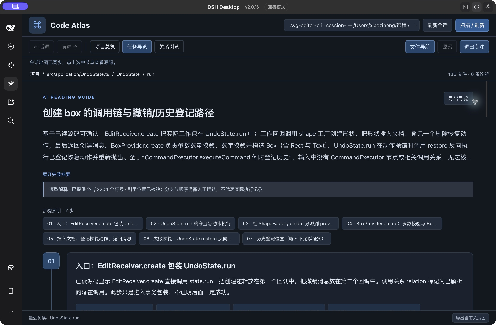
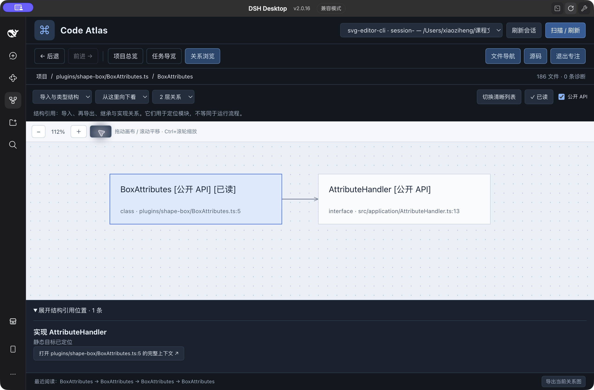

> 历史验收记录。对应 `code-atlas-v0.2.0`；当前版本见 [本版验收](code-atlas-verification.md)。

# Code Atlas 0.2 验证记录

记录日期：2026-11-26。最终实现提交：`45847bb17c98e1c79ef79e40996a93e4929493fd`，分支 `feat/dsh-code-atlas`。

## 结果与范围

本版已完成源码、构建、独立 profile 安装、安装后宿主扫描、自动检查与**真实桌面交互验收**。先前因锁屏暂停的操作在使用者解锁后继续。最终安装包完整重启后重新扫描成功；验收结束已恢复原 DSH 窗口和原有会话。

| 检查 | 实际结果 |
|---|---|
| Phase 1/2 CLI 回归 | 198 / 198 通过；4 份基线输出逐字节一致；原扩展差异检查通过 |
| VSCode 扩展回归 | 10 / 10 通过 |
| 原 DSH SVG 扩展回归 | 14 / 14 通过 |
| Code Atlas | 76 / 76 通过，无跳过；类型检查通过 |
| 总计 | 298 项通过；既有 222 项运行代码未改动 |
| 安装包 | `dsh-code-atlas-0.2.0.tgz`，SHA-256 见同目录 JSON |
| 安装后验证 | 从独立 profile 加载插件及 TS7，从已安装 Desktop 加载真实 SDK，扫描本仓库，生成 SVG |
| 宿主注册与卸载 | 7 个工具、17 个原生接口；卸载插件实例后工具为 0，服务拒绝后续调用 |
| 模型测试 | 自动测试使用替身；明确授权后另成功调用一次配置模型，返回 7 步导览并导出 |
| 本版桌面截图 | 14 张真实截图，见下文；最终重启界面与安装记录相符 |

自动检查原始输出见 [code-atlas-0.2-tests.txt](verification/code-atlas-0.2-tests.txt)，安装后宿主记录见 [code-atlas-0.2-installed.json](verification/code-atlas-0.2-installed.json)。模型导览的代码引用校验并不能证明模型解释正确，也不能代替真实界面操作。

## 针对反馈的检查

- Remote Adapter：逐项核对全部 16 个普通调用的参数顺序、接收对象与 `false` 值；错误保留代码和详情；传输层异常不被覆盖；订阅使用原句柄，能释放。
- 原生流：真实 rc.1 Gateway 与工具共用实例状态，慢消费者只接收最新视图；取消、关闭会话和卸载终止订阅。
- 导航：后退与前进恢复节点、方向、层数、关系类型、刚修改的搜索词及面板状态；新分支移除前进路径；源码过期时不移动历史游标，也不改变原路线。
- 大项目阅读：实际 React 组件以 1,000 文件测试分页与搜索，以 20,000 行源码测试局部上下文；这些是组件行为检查，不是屏幕布局验收。
- 调用事实：跨文件、别名和构造目标；匿名回调单独归属；属性调用只标记声明目标，不声称已经确定动态实现。
- AI 导览：有界函数正文与最多 240 个调用位置；只允许引用实际提供过的源码节点；源文件变动、刷新、无效步骤、响应中断和取消均有检查。预取消请求不会调用模型。
- 点名方法：真实模型首先指出未读到 `CreateCommand` / `CommandExecutor`。修复后任务点名的方法优先收录；大量邻近回调不能挤掉它们，限定名称的子串也不算点名。真实仓库回放确认本任务的 7 个点名方法全部进入上下文，见 [named-task-context.json](../extensions/dsh-code-atlas/examples/named-task-context.json)。该回放没有额外调用模型。
- 模式：装饰器组合顺序、两种阅读策略、观察者释放继续测试。新增测试文件标签的零改动证据比较历史提交 `7a5cfbf → 552a7e7`，不把本次功能升级误说成分析器没有改动。

## 如何试用与继续验收

本机独立测试环境已安装本版。打开该环境，在侧栏选择“代码地图”，选择 SVG 仓库会话，点击“扫描 / 刷新”。源码为只读。

1. **先找范围**：在项目总览展开模块，搜索 `CommandExecutor.executeCommand` 并选中。跨文件调用可以逐个阅读，后退保留上一位置；无需一次展开全部文件。
2. **看局部关系**：函数或方法切换到“调用参考”，类与文件可查看“导入与类型结构”。1 层是当前节点的直接关系，2 层再沿关系走一步；层数不表示实际执行先后或调用栈深度。
3. **让模型梳理一项任务**：输入“创建 box 时输入如何传到文档，失败如何恢复、何时登记历史”。点击生成，检查步骤、分支、核验问题和代码范围。这个操作使用 DSH 配置的默认模型并可能产生费用。
4. **核对代码**：点击步骤中的源码引用，或展开调用位置。源码每次显示至多 180 行，可翻页、放大字号；证据面板默认收起。
5. **复杂时收窄**：选择一个更具体的方法或回调，再生成下一段导览。单轮有范围限制；文件过多、关系密集时用模块、搜索与清晰列表逐步阅读。
6. **保留材料**：导出当前 SVG，或导出含使用者步骤核验标记的 Markdown。导览勾选保留在当前视图，跨重启不持久保存。

完整安装和卸载步骤见 [扩展 README](../extensions/dsh-code-atlas/README.md)。包管理器可能提示宿主 peer 未在 profile 内安装：这些依赖由 Desktop 的模块解析器提供，本次安装后验证实际使用 Desktop 2.0.16 / DSH 0.2.0-rc.1 / Cordis 4.0.4；不另装一套重复宿主服务。

### 已完成的真实操作

- 在 Desktop 2.0.16 / DSH 0.2.0-rc.1 中重启最终安装包：186 个源码文件、2,227 个符号、9,315 个静态调用位置，无分析诊断。
- 总览、限定名称搜索、分栏拖动、专注模式、源码字号 15→17px、折行、定位行居中均检查。专注中点击代码引用会退出专注并显示源码。
- `EditReceiver.create → UndoState.run` 跨文件跳转，后退恢复原节点并收起源码，前进恢复目标及源码面板。
- 真实模型生成 7 步导览；长摘要默认收起、步骤索引、失败分支定位、代码引用与 Markdown 导出检查。原始输出见 [native-model-box-guide.md](../extensions/dsh-code-atlas/examples/native-model-box-guide.md)。其中“仍需确认”的内容是模型建议，不作为已经证明的缺陷。
- 搜索 `AttributeHandler`，沿上游找到 `BoxAttributes`，再切回下游、两层关系，核对 `implements` 第 5 行，标记已读。
- 清晰列表、缩放、适应与拖动平移检查；导出的 [native-desktop-map.svg](../extensions/dsh-code-atlas/examples/native-desktop-map.svg) 经 XML 解析，含 2 个代码节点及已读标签。
- 在原生插件管理界面停用，入口消失；重新启用，入口恢复。宿主卸载后工具为 0、服务不可调用另由安装包原生验证与测试确认。
- 最终版本取消 SVG 保存对话框后，只显示“已发起 SVG 导出，请确认文件已保存”，未误报完成。
- 关闭测试实例，恢复原 DSH 默认工作区和原有历史会话。独立 profile 保留为已安装且启用状态。

真实模型这次收到 24 个符号、8,781 字符源码及 56 个调用位置。其后修复了点名方法选择并做离线回放；保留首次在线输出的缺口，不以改写内容冒充第二次在线结果。真实模型取消、超时、无配置等错误路径由无网络原生服务测试覆盖，本轮未另行付费调用这些分支。

### 真实截图





| 图片 | 观察结果 |
|---|---|
| [01 项目总览](images/code-atlas-0.2/01-project-overview.jpg) / [14 最终包重启](images/code-atlas-0.2/14-final-installed-overview.jpg) | 项目入口、模块、真实扫描数量 |
| [02 在线模型结果](images/code-atlas-0.2/02-real-model-guide.jpg) / [04 步骤索引](images/code-atlas-0.2/04-guide-focus-index.jpg) / [05 失败分支](images/code-atlas-0.2/05-guide-branch.jpg) | 实际模型解释、范围提示、分支定位 |
| [03 跨文件源码](images/code-atlas-0.2/03-cross-file-source.jpg) / [06 专注中打开源码](images/code-atlas-0.2/06-focus-source-reveal.jpg) / [07 调整分栏](images/code-atlas-0.2/07-resized-source.jpg) | 源码定位、折行、面板宽度 |
| [08 实现证据](images/code-atlas-0.2/08-implements-source.jpg) / [09 清晰列表](images/code-atlas-0.2/09-clear-list.jpg) / [10 大幅地图](images/code-atlas-0.2/10-map-focus.jpg) / [11 平移](images/code-atlas-0.2/11-map-pan.jpg) | 接口实现、已读、视角与画布 |
| [12 停用](images/code-atlas-0.2/12-plugin-disabled.jpg) / [13 恢复](images/code-atlas-0.2/13-plugin-enabled.jpg) | 入口释放及重新装载 |

## 复现

在仓库根目录运行：

```sh
npm run check
npm test
npm run verify
npm run verify:extensions
npm --prefix extensions/vscode-svg test
npm --prefix extensions/dsh-svg test
npm --prefix extensions/dsh-code-atlas run check
npm --prefix extensions/dsh-code-atlas test
npm --prefix extensions/dsh-code-atlas run demo
node extensions/dsh-code-atlas/scripts/demo-guide.mjs
node extensions/dsh-code-atlas/scripts/verify-extension.mjs
node extensions/dsh-code-atlas/scripts/local-desktop.mjs verify
```

正式归档由 `node scripts/package-code-atlas.mjs` 创建，要求已提交源码、版本一致、包哈希匹配验证记录，以及真实桌面验收通过。先前预览归档保留自身的旧源码版本与包哈希。
