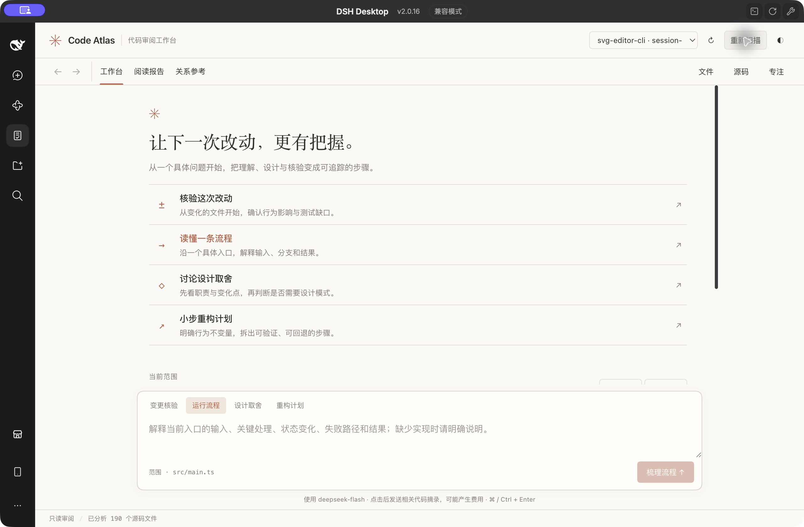
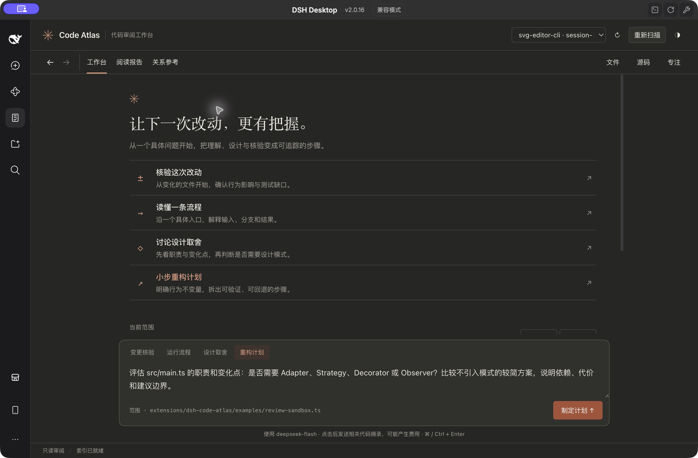
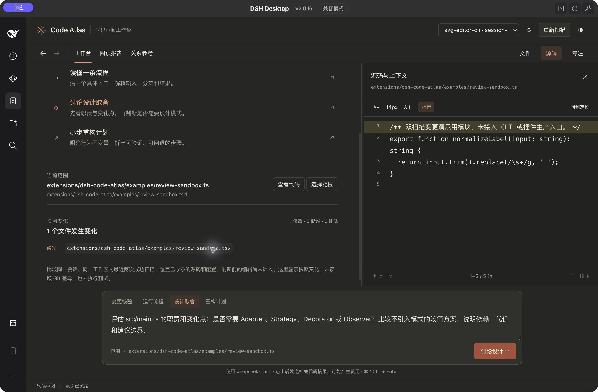

# Code Atlas 0.3 验证记录

记录日期：2026-11-26。实现提交：`b727d7a4edef91e01f4cc37243e6f33ab08d0cbf`；分支 `feat/dsh-code-atlas`。实际版本、包哈希和截图哈希见 [机器可读记录](code-atlas-verification.json)。

## 结果与范围

本次完成任务工作台重构、四种审阅意图、两次扫描的文件变化比较、构建安装和下列真实桌面检查。**本轮没有额外调用付费模型**：四种意图使用无网络原生替身测试；不能据此声称四种报告都已在线验收。

| 检查 | 实际结果 |
|---|---|
| CLI / VSCode / 原 DSH SVG 回归 | 198 + 10 + 14 项通过，原运行代码相对上次验收提交无改动 |
| Code Atlas | 84 项通过，无跳过；含新增意图、比较基线与工作台组件检查 |
| 合计与类型检查 | 306 项通过，0 失败、0 跳过；四组类型检查通过 |
| CLI 契约 | 4 份基线输出逐字节一致；原扩展差异检查通过 |
| 安装包 | `dsh-code-atlas-0.3.0.tgz`，SHA-256 `50a9d8f071822ab4e8c197222e2cd3bec065cac40a55d5f3e0af2118e40a3e09` |
| 安装后宿主验证 | 独立 profile 的已安装包、TS7 与真实 Desktop SDK；扫描本仓库 2,501 节点、10,533 关系，生成 SVG |
| 注册与释放 | 7 个工具、17 个原生接口；卸载实例后工具 0 个，后续服务调用被拒绝 |
| 真实界面 | 浅/深色工作台、任务选择、扫描对比及变化文件源码定位；见下文 |
| 原环境 | 退出测试窗口后恢复原 DSH 默认工作区及历史会话，保留测试 profile |

原始输出：[306 项测试](verification/code-atlas-0.3-tests.txt)、[类型检查](verification/code-atlas-0.3-typechecks.txt)、[CLI 验证](verification/code-atlas-0.3-cli-verification.txt)、[示例与历史扩展证明](verification/code-atlas-0.3-examples.txt)、[已安装包原生验证](verification/code-atlas-0.3-installed.json)。

## 本轮真实桌面操作

使用 Desktop 2.0.16 / DSH 0.2.0-rc.1 / Cordis 4.0.4，最终包安装到独立 `/private/tmp/atlas-dsh-home` 测试环境。完整重启应用，避免只刷新客户端却仍使用旧宿主代码。

1. 进入“代码审阅”，选择 SVG 仓库会话，扫描建立比较起点。工作台默认收起文件和源码，SVG 关系图不占首屏。
2. 查看纸白、暖灰和陶土橙的浅色布局；切换暖深色。四类任务行、底部输入、关系参考入口均可见。
3. 只修改演示模块 `extensions/dsh-code-atlas/examples/review-sandbox.ts`：将 `input.trim()` 改为 `input.trim().replace(/\s+/g, ' ')`。该文件未接入 CLI 或插件入口。
4. 再次成功扫描，实际显示 **1 修改 / 0 新增 / 0 删除**。点击变化文件后打开带行号的当前正文，保持“工作台”页，未跳到关系图。
5. 选择设计取舍任务，确认填写了可编辑问题；切换重构意图，按钮及提示更新。没有点击模型生成按钮，没有额外模型请求。
6. 关闭隔离测试窗口，重新打开原 DSH，确认恢复“默认工作区”和原有历史会话。

桌面无障碍树原始记录见 [本次界面记录](verification/code-atlas-0.3-desktop-ui.txt)。该记录只包含独立测试页面。安装后卸载验证由原生脚本执行；本轮未重复所有旧版地图操作，也未把旧截图列为新界面截图。







## 新增与保留的重点检查

- 四种可信意图：缺省 `flow` 兼容旧调用；枚举由服务端校验；模型返回不能替换真实意图；原生接口正确转发可选参数。
- 快照基线：首次扫描无比较、连续扫描新增/修改/删除、失败保留、工作区切换、相同源码的新比较使旧报告失效；删除路径不能跳转旧位置。
- 有界上下文：变化文件轮询分配片段，纯样式/常量源码文件可提供文件正文；无法分析的配置路径明确列出缺口，不能以无关入口代替；预算与源码版本检查保留。
- 工作台：任务选择不调用模型，66 条变化以 30 条分页，删除项无导航按钮；文件点击保留当前主页面并展开源码。
- 报告与安全边界：共享步骤协议、实际引用、过期源码和快照拒绝、错误/取消与无模型分支继续通过无网络测试。设计与重构要求比较简单方案、行为不变量、验证及回退，不声称已修改或测试。
- Remote Adapter：全部普通调用的参数与接收对象、错误代码/详情、传输异常、原始流句柄及订阅释放继续有专项测试。它们是接口契约验证，不能替代界面验收。
- 课程模式：标签装饰组合、依赖/使用者策略、实例观察者释放继续通过。测试文件标签的零核心改动证据特指历史 `7a5cfbf → 552a7e7`；本次升级实际修改了工作台核心，不能把历史结论扩大。
- 示例：重新生成暖色 SVG、6 步助理编写的创建 box 示例及 7 个点名方法的离线上下文回放；它们不冒充在线模型结果。

## 仍须了解的限制

“变化”是同一会话同一工作区相邻成功扫描的文件哈希差异，**不是 Git diff**，没有上一版正文、精确改动行或 AI 编写者识别。变化文件可能只提供部分当前符号；例如含函数的文件中顶层常量修改可能不在所选函数正文里。列入变化清单不等于模型已经逐项读完全部改动。

报告是针对有界当前片段的建议，不证明运行顺序或正确性。本版不执行被分析项目的测试、不应用补丁、不自动重构。检查框只是阅读记录；阅读状态和比较基线不跨重启持久保存。

[0.2 历史验收](code-atlas-verification-0.2.md)及[历史 JSON](code-atlas-verification-0.2.json)单独保留，其中此前授权的一次在线模型记录只属于旧版范围，不作为本版四意图在线证明。

## 复现与交付

在仓库根目录：

```sh
npm run check:all
npm run test:all
npm run verify
npm run verify:extensions
npm --prefix extensions/dsh-code-atlas run demo
node extensions/dsh-code-atlas/scripts/demo-guide.mjs
node extensions/dsh-code-atlas/scripts/verify-extension.mjs
node extensions/dsh-code-atlas/scripts/local-desktop.mjs verify
```

安装与卸载见 [扩展使用说明](../extensions/dsh-code-atlas/README.md)；设计判断与后续方向见 [0.3 设计说明](code-atlas-v3.md)。源码和验收记录提交后，由 `node scripts/package-code-atlas.mjs` 生成包含已提交源码、tgz、示例、截图和清单的 ZIP，并核对版本与安装包哈希。原有 0.2 标签和归档保留。
