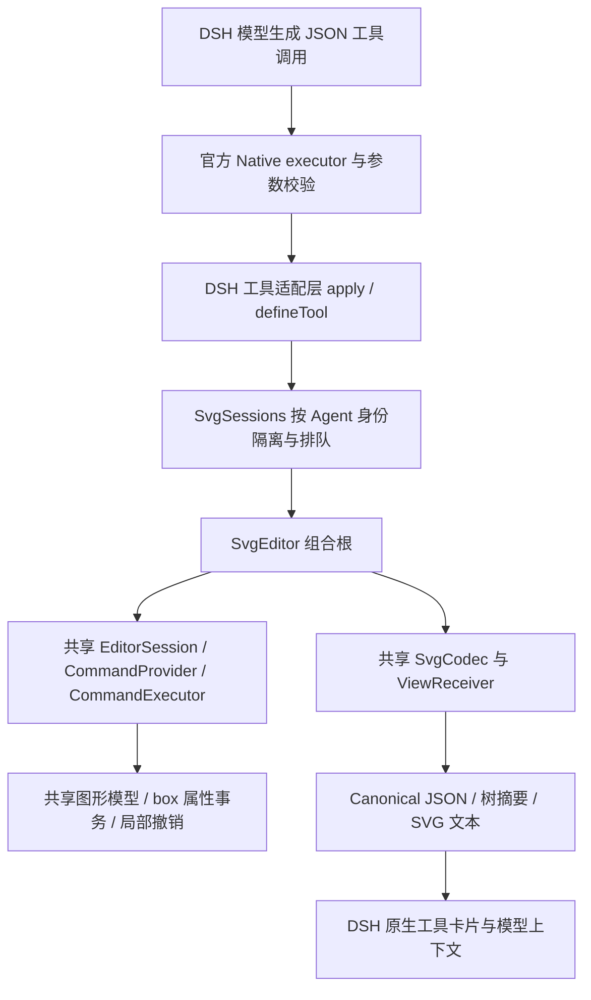

# 第三部分：DSH SVG 会话工作台

## 交付与验证范围

交付位置为 `extensions/dsh-svg`，包名 `dsh-svg-workbench`。实现七个模型工具，支持同会话的持续 SVG 编辑、结构查询、局部撤销/重做和文本导出；复用 Phase 2 的图形、命令、box、属性处理器及树标签。打包后能作为 DSH bundle 安装。

2026-11-23 本地实测使用 Node.js 24.16.0、Cordis 4.1.0、`@deepseek-ai/dsh-tools` 和官方 Native executor 的 **0.2.2-rc.5**。14 项自动测试全部通过；13 次工具演示调用通过；tgz 解压到临时目录后再次完成注册、创建 box、导出和卸载。完整调用结果位于 [tool-transcript.json](../extensions/dsh-svg/examples/tool-transcript.json)，图形产物为 [approval.svg](../extensions/dsh-svg/examples/approval.svg)。

这是一组真实官方宿主组件上的集成测试，不是伪造 DSH 上下文或直接调用业务函数。测试使用官方 `executeModelToolFixture` 将 JSON 调用交给实际 ToolsService/Native executor，由官方 schema 校验、调用插件并规范化 canonical value 和 content。测试无需模型服务；本次没有发送模型请求、记录完整 Agent 对话日志，或声称完成 Desktop/Web 的模型对话截图。

机器上原有 DSH Desktop 2.0.16 内置 DSH 0.2.0-rc.1，低于本包固定的 SDK 版本。因此没有将新接口包强行装入用户的旧 profile，也没有升级用户环境或访问其凭据。包明确声明 `engines.dsh: 0.2.2-rc.5`。匹配环境的安装步骤、测试命令和产物路径见 [插件 README](../extensions/dsh-svg/README.md)。

## 为什么选择这个插件

已有项目的价值是确定性的图形编辑和局部恢复，而模型适合解释自然语言、规划操作并引用真实节点。插件将两者接起来：模型先 inspect 获取 ID 和属性，再执行明确编辑；模型不需要手写整个 SVG，也不用在每次修改时重新生成所有图形。

典型演示是“提交申请 → 审批 → 归档”：创建三个 box 和两条线，分组，改审批标题和填充色，移动后撤销该移动，导出 SVG。一次工具编辑是一条 Command 和一个历史单元；一句自然语言产生多条工具调用时，undo 只恢复最后一条成功编辑。

现有 DSH 图解插件 [dsh-diagram](https://github.com/hanzhangzzz/dsh-diagram) 采用可编辑画布。本项目选择按 ID 连续编辑与可验证历史作为当前重点，初版使用宿主原生 generic 工具卡片，结果包含真实树和编辑反馈。客户端图形画布、自动布局、连线跟随及设计模式教学模板留作扩展，不作为本版已实现功能。

## 模块与调用过程

| 模块 | 隐藏的知识与职责 |
|---|---|
| `src/index.ts` | DSH 的插件生命周期、工具 schema、模型输出与 generic 展示协议 |
| `SvgSessions` | 从 `exec.agent.id` 取得身份、会话隔离、串行执行、关闭与卸载 |
| `SvgEditor` | SVG 框架的装配与应用调用；不解释 box 子结构或属性白名单 |
| `SvgMemoryStore` | 将输入 XML 文本适配到既有 DocumentStore 端口；无任意文件访问 |
| `SvgToolError` | 将预期领域错误转为 DSH 可保留的稳定错误码 |
| CLI 公开 API 和现有插件 | 所有图形、树规则、命令、属性语义、撤销和 XML 校验 |

`apply(ctx)` 的签名来自真实 DSH 框架，使用函数入口是适配协议，不另造抽象生命周期。`inject=['tools']` 让 Cordis 等待工具服务；`ctx.tools.register(defineTool(...))` 注册工具。DSH 负责何时调用工具、参数规范化与失败呈现；插件负责领域操作与结果。工具注册是 effect，卸载自动撤销注册；插件另外用 effect 清理自己的会话 Map。

## 对 CLI 的实际复用

业务入口从 `src/api/index.ts` 导入；组合根专用服务通过公开 `src/api/integration.ts` 使用 `ExtensionRegistry` 和 `SvgCodec`。没有导入 EditReceiver、History、UndoState 的实现细节，也没有依赖 CLI Host/Runtime、文本解析器或主入口。

- 默认图形、默认命令、box、modified-star 使用现有包及真实 manifest，通过现有 Registry 激活。
- `svg_edit` 的 operation 与参数数组交给对应 CommandProvider；通过同一 CommandExecutor 执行，保持局部撤销和失败回滚。
- box 的 label/fill 行为仍由原 AttributeHandler 决定，DSH 层不识别其内部矩形和文字 ID。
- SVG 读入/编码使用现有 Codec；ViewReceiver 生成查询文本；dirty 语义沿用成功读入基准。
- 打包器把这些模块和 XML 依赖编入安装包，DSH SDK 保持 external peer，避免一个进程出现两份框架服务实例。

公开 integration 入口是跨宿主集成需要的稳定边界，不要求其他宿主引用私有实现路径。CLI 行为和历史接口继续由原回归测试保护。

## 状态、并发和失败契约

每个 Agent ID 对应一个编辑器。工具参数没有可写 sessionId，模型不能通过输入切换别人的画布。Map 存在 SvgSessions 实例中，由每次插件 apply 创建；没有模块级可变会话状态。

同一会话的调用按进入顺序串行，后一个调用在前一个完成后开始；失败不会让队列永久拒绝。不同会话使用不同文档和历史。取消信号在入队前及实际执行前检查；短同步领域修改开始后完成本条事务，不在中途制造半个编辑。已关闭/卸载的会话不能启动尚未执行的排队工作。

成功 create/open 重建画布并清空历史。inspect/export 是查询，不改变版本、dirty 或 undo/redo；export 直接编码内存文档，不调用 `EditorSession.save()`，因此不会意外建立 CLI 的保存屏障。持久化由 DSH 现有文件工具处理，用户显式指定目标文件。

agent/disposed 清除对应编辑器，svg_close 主动释放本会话，插件卸载清理全部 Map。内存文档和历史不跨进程重启保留，应在需要时导出后保存。默认资源限制为最多 100 个编辑器、输入 SVG 1,000,000 个字符、每次编辑 100 个参数且每项 10,000 字符。

领域错误被包装为 HarnessError 子类 SvgToolError，保留错误码。官方 schema 失败和取消保留宿主自己的错误分类。失败不会将错误当成成功文本，也不会在失败后执行另一条回退编辑。自动测试对失败前后的完整 SVG、版本和双向历史做断言。

## 与课件设计原则和模式的对应

| 原则或模式 | 实际应用 | 取舍 |
|---|---|---|
| 深模块 | 少量工具隐藏图形校验、局部补偿、历史和 XML 细节 | 模型只需真实节点 ID 与一条明确操作 |
| 信息隐藏 | DSH 协议留在适配层，会话规则留在 SvgSessions，box 结构留在原插件 | 避免同一结构知识散到模型工具和 CLI 两边 |
| Adapter | DSH JSON/ToolRunContext 转为应用请求；内存 XML 转为 DocumentStore | 核心不依赖 DSH 类型、文件系统或 UI |
| Command | 共享 CommandProvider、CommandExecutor 和局部撤销 | 不新增第二套历史，不通过 shell 拼接命令 |
| Decorator 思路 | 复用 tree-star 和 box-type-label 的有序标签组合 | 显示规则不侵入 Shape；不声称是完整 GoF 同接口递归包装 |
| Strategy | 已有图形构造与属性行为从策略式 provider/handler 选择 | 没有为尚未存在的自动布局另加 LayoutStrategy |
| Observer 的适用范围 | 仅订阅真实宿主 agent/disposed 清理状态 | 不另设编辑事件总线，避免多处同步同一个 dirty 状态 |
| 稍微通用、减少变更放大 | 七个工具覆盖当前编辑闭环，复用公开 API 与插件装配 | 不新增万能服务定位器、原子批次和客户端预览体系 |

## AI 建议的检查与修正

| 初始建议或假设 | 检查方式 | 采用的修正 |
|---|---|---|
| 直接按较早探索稿写 DSH API | 阅读固定官方源码和 SDK 类型，运行真实工具流水线 | 使用真实 apply / inject / defineTool / canonical output，而非杜撰 ctx API |
| 最新 npm dist-tag 就是本次兼容版 | 对比官方仓库版本、发布包与本机 Desktop 内置包 | 精确锁 0.2.2-rc.5；明确旧 Desktop 0.2.0-rc.1 不在兼容范围 |
| preview/export 可以调用 save | 检查 EditorSession.save 的历史屏障 | export 只编码内存，不清空历史；文件保存交回宿主 |
| 同一个全局 EditorSession 足够 | 两个 Agent 使用相同节点 ID 并交叉 undo | 按真实 Agent 身份隔离；会话 Map 绑定插件实例并显式清理 |
| 多个工具并发无需额外约束 | 并发 create/move/move 测试 | 同会话串行执行，按实际进入顺序修改 |
| 导出再导入的 XML 应逐字节相同 | 观察合法 XML 属性顺序会变化 | 验证语义、类型、结构与内容；不将属性排序变化误判为图形丢失 |
| 导入 SVG 可以直接当 HTML 预览 | 检查核心保留的导入属性和浏览器执行边界 | 本版只输出文本/generic 卡片，不注入 HTML；预览需要独立安全边界 |
| 只有 package main 就可自动启用 | 核对官方 bundle/profile 教程 | 增加 dsh.bundle.patch、cordis.patch.yml 及 engines.dsh；测试打包后的独立加载 |
| 公开仓库等于可以任意选 MIT | 检查仓库未声明统一许可 | 包标为 UNLICENSED/private，保留 XML 库的第三方许可证，不发布 registry |

## 证据与复现

在 `extensions/dsh-svg` 内依次执行 `npm ci`、`npm run check`、`npm test`、`npm run demo`、`npm run package`、`npm run verify:package`。共享核心依赖由仓库根 `npm ci` 安装。CI 可以独立执行相同步骤，不需要用户凭据。

测试与产物位置：

- [测试源码](../extensions/dsh-svg/test/workbench.test.mjs)：14 项真实宿主测试。
- [固定演示输入](../extensions/dsh-svg/examples/approval-tools.json)：13 次调用，不含模型猜测或额外命令。
- [真实结果记录](../extensions/dsh-svg/examples/tool-transcript.json)：canonical value、模型 content 和 SDK 版本说明。
- [生成的 SVG](../extensions/dsh-svg/examples/approval.svg)：改标题、改色、移动后 undo 的结果。
- `extensions/dsh-svg/artifacts/dsh-svg-workbench-0.1.0.tgz`：可安装构建包，构建产物不直接混入源码提交。

## 官方依据与版本

接口核验以 deepseek-ai/deepseek-harness 提交 `2e39e70496aa02986ca6a820c5d497e816b69d7e` 对应的 0.2.2-rc.5 源码和 npm 精确版本为准：

- [官方工具开发教程](https://github.com/deepseek-ai/deepseek-harness/blob/2e39e70496aa02986ca6a820c5d497e816b69d7e/docs/user/develop/basic/tool.md)：apply、inject、defineTool、parameters 与 output。
- [官方工具执行契约](https://github.com/deepseek-ai/deepseek-harness/blob/2e39e70496aa02986ca6a820c5d497e816b69d7e/docs/cookbook/adding-a-tool.md)：canonical value、错误、取消、纯展示和 effect 生命周期。
- [官方打包安装教程](https://github.com/deepseek-ai/deepseek-harness/blob/2e39e70496aa02986ca6a820c5d497e816b69d7e/docs/user/develop/basic/publish.md)：bundle/profile、peer、patch 及 tgz 安装。
- [官方工具 testkit](https://github.com/deepseek-ai/deepseek-harness/blob/2e39e70496aa02986ca6a820c5d497e816b69d7e/packages/test-support/tool-testkit/README.md)：无模型调用的真实执行流水线测试及其不包含根会话日志的边界。

作业第三部分建议开源和发布市场，并未要求必须执行发布。本次提供源码、安装包和真实 SDK 验证；公开分发许可和插件市场发布仍需项目所有者后续选择。
