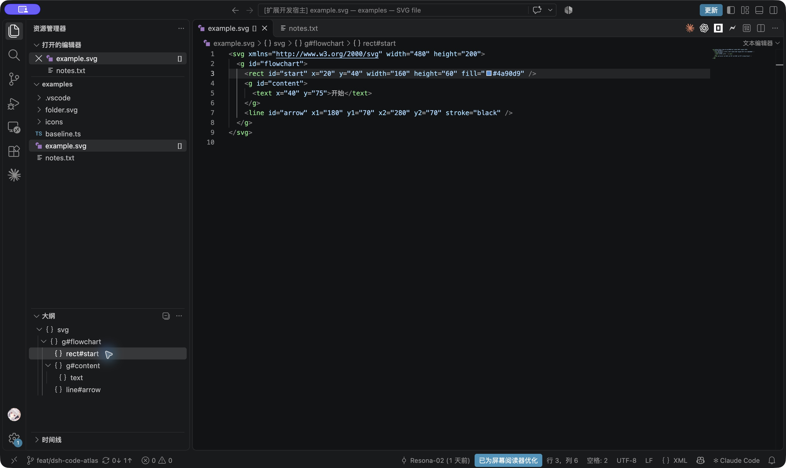

# VSCode 第一部分 A.1～A.3 复核结果

复核日期：2026-11-25。结论：当前实现满足所给第一部分的功能与分析交付要求；未发现阻断性漏项。此结论仅针对 VSCode 部分。

## 逐项验收

| 要求 | 核验结果 | 证据 |
|---|---|---|
| A.1 SVG 文件显示 `[]` | 满足，作为 FileDecoration 显示，不改名或写入文件 | `SvgFileDecorations.ts`；本次界面截图 |
| 普通文件与目录不标记 | 满足，同时检查后缀与实际 FileType；`folder.svg` 目录不误标 | 真实文件系统断言；截图中的 notes.txt、folder.svg、icons |
| A.2 使用原生大纲 | 满足，注册 DocumentSymbolProvider，没有创建替代大纲视图 | `extension.ts`、`SvgDocumentSymbols.ts` |
| 根、容器、叶子的嵌套层级 | 满足，含 svg、两层 g、rect、text、line | 解析测试、原生查询及截图 |
| 有 id / 无 id 的名字 | 满足，分别显示 `rect#start` 和 `text` | 解析与宿主检查、截图 |
| 点击定位源代码 | 满足，本次点击 rect#start 后状态栏为第 3 行、第 6 列 | 本次截图；宿主 selectionRange 断言 |
| 编辑后更新 | 满足，读取当前 getText()，未保存编辑亦生效 | 宿主检查 start→edited；既有更新截图 |
| 不完整 XML 不崩溃 | 满足，返回空符号列表，恢复文本后树恢复 | 解析与宿主检查；既有异常截图 |
| 先观察现有大纲 | 已有 TypeScript 类与方法导航观察记录 | baseline.ts、原生观察截图 |
| A.3 源码、启动、示例、截图 | 齐全 | 扩展源码、README、example.svg、docs/images |
| 职责和注册调用过程 | 已说明宿主负责显示和查询，插件提供能力与数据 | vscode.md 职责表及调用时序图 |
| 模式与 Phase 1 复用分析 | 已说明对应关系、差异和复用边界 | vscode.md、REUSE.md |

## 实际界面

本次真实 VSCode 开发宿主截图同时显示：Explorer 的 `example.svg` 旁有 `[]`；普通文件与目录无该标记；原生大纲含无 id 的 `text`；选中 `rect#start` 后源码定位到第 3 行、第 6 列。

其余真实截图：

- [原生 TypeScript 大纲观察](../docs/images/vscode-outline-baseline.png)
- [独立文件标记演示](../docs/images/vscode-svg-badge.png)
- [未保存编辑后大纲更新](../docs/images/vscode-svg-edited.png)
- [不完整 XML 时大纲清空](../docs/images/vscode-svg-incomplete.png)

## 课件设计原则核对

1. **Decorator**：课件要求同接口、持有上游并委托。文件标记保留附加显示职责、规则与内容分离的意图，但 provider 不包装 Explorer，也不实现 Explorer 的组件接口，因此文档明确它与经典结构的差异。不能把 API 名称当成模式证明。
2. **Adapter**：`SvgDocumentSymbols` 实现宿主接口并持有 `SvgOutlineParser`，将独立节点与 UTF-16 偏移转成 VSCode 的 DocumentSymbol/Range。文件标记另有 FileStat 到附加标记的数据转换，但不因此泛称所有 provider 都是经典适配器。
3. **信息隐藏与独立变化**：XML 和源位置知识封装在 parser；VSCode 类型封装在 provider；文件显示规则不进入 SVG 图形领域模型。注册与释放集中在 activate 组合根。
4. **深模块与适度复用**：少量 provider 方法封装解析、取消和异常处理。复用 XML 库与有序树遍历思路；Phase 1 编辑模型会补 id、限制元素且不保留范围，不适合直接充当源码树。没有为模式数量额外加入语言服务器或事件总线。

## 本次运行与证据边界

- `npm --prefix extensions/vscode-svg run check`：通过。
- `npm --prefix extensions/vscode-svg test`：10 项通过。
- `npm --prefix extensions/vscode-svg run test:vsix`：真实 VSCode 1.146.0 中 14 项检查通过。
- 安装包主入口与当前构建入口逐字节一致；示例文件磁盘内容无改动。
- VSIX SHA-256：`74071b8982f354f7579dc3239e269cf3ecb241f6f3ef520d5603e3733ab5293e`。

宿主测试通过原生命令验证包内大纲；文件标记断言直接调用源码编译的 provider，并使用真实 workspace.fs。界面截图另行确认实际 badge 显示。开发宿主截图与 VSIX 自动检查是两种证据，不能混称一次完整的鼠标安装验收。

已说明的范围：需要以文本编辑器打开 SVG；错误 XML、DTD/ENTITY 声明返回空大纲；不提供完整 SVG 规范校验或图形预览，这与题目允许的范围一致。

原始只读任务文件 `phase_cli_2.md` 的两处示意图路径为 `.jpg`，仓库实际截图为 `.png`。原文保留，本文和交付说明均使用可打开的 `.png` 路径。

## 安装与展示

在 VSCode 扩展视图选择“从 VSIX 安装”，选择 `extensions/vscode-svg/svg-software-lab-0.1.0.vsix`，打开示例目录，将 example.svg 以文本打开并展开“大纲”。也可按[扩展 README](../extensions/vscode-svg/README.md)运行 **Run SVG Extension** 调试配置。

源码：[extensions/vscode-svg/src](../extensions/vscode-svg/src)。完整[设计说明](vscode.md)及[复用评估](../extensions/vscode-svg/REUSE.md)可随作业一起提交。
