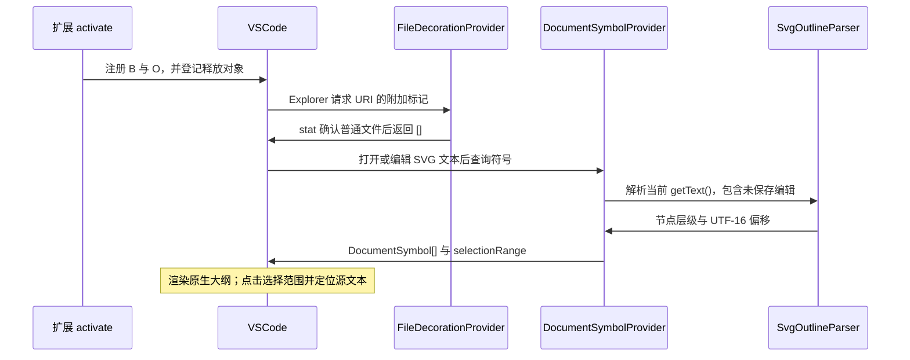

# 第一部分：VSCode SVG 插件实践

## 交付与观察

实现位于 `extensions/vscode-svg`。安装、F5 启动和打包步骤见[插件 README](../extensions/vscode-svg/README.md)，示例为 [example.svg](../extensions/vscode-svg/examples/example.svg)。

接入 SVG provider 前，先用 TypeScript 文件观察原生 Outline：类下面显示方法；点击 draw 后，编辑器移动到第 2 行；大纲由语言功能提供符号，展开、选中和导航由 VSCode 负责。[原生行为截图](../docs/images/vscode-outline-baseline.png) 保留了这次观察。SVG 实现沿用同一视图和交互，没有另建模拟大纲树。

2026-11-23 在真实 VSCode 1.146.0 的扩展开发宿主中验证了以下行为。截图来自实际界面，未用示意图代替；临时编辑完成后已撤销，示例磁盘内容不变。

| 要求 | 实现与证据 |
|---|---|
| `.svg` 文件旁显示 `[]`，不改名 | SvgFileDecorations 返回 FileDecoration；[文件标记截图](../docs/images/vscode-svg-badge.png) |
| 非 SVG 与目录不标记 | 先检查后缀，再用 workspace.fs.stat 确认 FileType.File；截图中 notes.txt、icons 和名为 folder.svg 的目录没有 `[]` |
| 根、容器、叶子按层级显示 | 原生 DocumentSymbol.children；[大纲截图](../docs/images/vscode-svg-outline.png) 显示 svg / g#flowchart / rect#start / g#content / text / line#arrow |
| 有 id 显示标签名#id，无 id 仅标签名 | 上述截图中的 rect#start 与 text；id 读取 XML 解码值 |
| 点击定位源码 | 点击 rect#start，编辑器定位第 3 行、第 6 列开标签；截图状态栏与高亮源码可核对 |
| 编辑后更新 | 不保存地将 id 改成 edited，大纲显示 rect#edited；[更新截图](../docs/images/vscode-svg-edited.png) |
| 输入不完整 XML 不崩溃 | 输入 `<svg><g id="unfinished"><rect`，原生大纲显示找不到符号；[异常截图](../docs/images/vscode-svg-incomplete.png)。撤销后树恢复 |

截图中的 `U` 来自 Git，表示文件当时尚未提交；插件仅提供 `[]`。SVG 若被现有图片扩展默认打开，应先选择文本编辑器。示例工作区自己的设置固定文本编辑模式，避免大纲导航重新打开图片预览；这不改变用户全局文件关联。

## 宿主与插件职责

| 主体 | 负责什么 |
|---|---|
| VSCode | Explorer 的目录和文件身份、文本缓冲区与版本、原生大纲、异步 provider 调用、文档编辑后的重新查询、点击导航和生命周期 |
| 扩展组合根 activate | 创建两个 provider；调用 registerFileDecorationProvider 和 registerDocumentSymbolProvider；将注册和 watcher 放入 context.subscriptions |
| SvgFileDecorations | 通过宿主文件端口判断实际文件类型，返回 badge/tooltip；文件创建、变更、删除时发出需重新查询的事件；不读写 SVG 内容 |
| SvgOutlineParser | 在任意 SVG XML 元素上构建独立于编辑器的数据树和 UTF-16 源码范围；不补 ID、不改变模型；输入损坏时返回空树 |
| SvgDocumentSymbols | 将纯数据树适配为宿主 DocumentSymbol、Range、SymbolKind；通过 document.positionAt 转换源偏移 |

文件 watcher 的事件仅通知 VSCode 哪个 URI 的附加信息需要重新查询，不直接修改 Explorer。扩展卸载时，注册、事件和 watcher 都通过 Disposable 释放。取消查询返回空结果；文件被删或不可访问时不产生标记。输入源一直属于宿主，插件没有建立另一份可写文件树。

## Decorator 与 Adapter 的对应及差异

经典 Decorator 的 Component 和包装对象实现相同接口，包装对象持有 Component，并在委托前后增加职责。VSCode 的文件装饰保留“附加显示信息、可以叠加、原对象身份不变”的意图，但 FileDecorationProvider 没有实现 Explorer 的组件接口，也不持有被包装的 Explorer。真正合并多种标记、处理视图和排序的是宿主。这里属于宿主扩展点上的装饰规则协作，不能因 API 名叫 Decoration 就断言完整的 GoF 类结构已出现。

这个分工接近课件中将内容提供者与标签装饰规则分离的例子：文件列表提供基本内容，本插件只补 `[]`，Git 仍可提供自己的状态。无需继承或修改 Explorer，不在文件名中拼接标记。

Adapter 对应得更直接：Client 是 VSCode 大纲调用者，Target 是 DocumentSymbolProvider，Adaptee 是不依赖 VSCode 的 SvgOutlineParser/OutlineNode，Adapter 是 SvgDocumentSymbols。适配器把节点树和源偏移转成宿主的 Symbol/Range；解析器不导入 vscode，宿主也不理解扫描、XML 验证和节点建树细节。文件 provider 使用 workspace.fs 这个宿主端口，而不是自己引入另一套磁盘遍历框架。

文件标记中的接口转换也应单独说明：VSCode 按 `FileDecorationProvider` 请求附加信息，`SvgFileDecorations` 调用 `workspace.fs.stat`，将文件类型事实转换成 `FileDecoration` 或无标记结果。这里有数据适配，但当前类没有显式持有独立的被适配解析对象；其主要角色是宿主回调 provider。不能仅因它实现了接口，就认定经典 Adapter 或 Decorator 的结构已经齐备。大纲中的 `SvgDocumentSymbols` 则明确持有 parser、实现宿主接口并转换不同的数据表示，是本扩展中更清楚的对象适配器实例。

## Phase 1 的复用评估

完整评估见 [REUSE.md](../extensions/vscode-svg/REUSE.md)。结论是：复用既有 XML 库及 Composite 树的组织思路，大纲另外保留源位置，不复用可编辑图形模型来假装源文本结构。

Phase 1/2 的 SvgCodec 会验证可编辑形状白名单、补缺失 ID、把字符串转换成几何模型，并且不保留每个源标签的范围；这对编辑器读写合理，但不适合 Outline。原生大纲还需要展示 path、defs 等不属于 CLI 子集的元素。直接复用会丢源位置、改变无 id 节点的名字，并让很多有效 SVG 无法导航。

纯解析器先做受限标记扫描并拒绝 DTD，再用既有 @xmldom/xmldom 验证 XML；扫描负责范围和引号边界，DOM 负责层级与解码后的 id。两者职责不同，没有重复实现整个 SVG 编辑模型。输入不完整时直接返回空数组，避免构造半棵误导导航的树。

## 课件原则与 AI 修正记录

- 信息隐藏：源码位置与 XML 语法留在 parser，VSCode 对象留在 adapter，文件标记不混入图形领域类。
- 深模块：provider 接口保持宿主规定的少量方法，背后封装取消、文件竞态和不完整输入；常用安装路径只需 VSIX。
- 避免过度设计：不为两个功能引入语言服务器、私有 Explorer、事件总线或完整 SVG 校验器。
- AI 建议“拿 CLI 的树直接展示大纲”：核对范围和无 id 行为后拒绝，改为独立源码树。
- AI 初始建议“凭 `.svg` 后缀加标记”：用 folder.svg 目录反例修正为 stat 文件类型检查。
- AI 初始解析假设 XML 库总会拒绝错误输入：测试发现裸 `&` 和某些不完整自闭标签可能被宽容处理，补边界验证与回归用例。
- AI 打包初稿外置 XML 库、可能依赖开发目录：改为单运行 bundle；VSIX 排除开发源码、测试和 node_modules，并单独解包运行验证。
- 实际 UI 检查发现现有图片预览关联会影响大纲导航：示例工作区限定文本编辑模式，并在安装说明给出“以文本打开”的操作。

## 自动化证据

10 项独立 parser 测试覆盖嵌套、无 id、重复查询、UTF-16/CRLF/中文/补充字符、引号内 `>`、注释、CDATA、任意 SVG 标签、命名空间、实体、损坏输入及范围包含关系。

真实 Extension Host 检查通过官方测试工具运行：实际扩展激活、实际 `vscode.executeDocumentSymbolProvider`、未保存编辑、异常输入恢复、源位置、真实 workspace 文件类型、取消和 Disposable。结果见 [vscode-host-evidence.json](vscode-host-evidence.json)。最终 VSIX 解包后使用同一真实宿主验收，结果见 [vscode-vsix-evidence.json](vscode-vsix-evidence.json)。截图证明界面表现，自动化断言证明范围、状态与源文件字节，二者互补。

2026-11-25 按 A.1～A.3 再次核对，类型检查、10 项解析测试和 14 项 VSIX 宿主检查通过，并在真实界面再次点击 `rect#start` 验证第 3 行、第 6 列定位。见[本次逐项复核](vscode-review.md)及[新截图](../docs/images/vscode-svg-review-2026-11-25.png)。文件标记的自动化断言直接调用源码编译的 provider 并使用真实宿主文件服务；包内大纲通过原生命令执行，界面截图另行确认标记显示。打包入口与本次构建入口逐字节一致，避免将不同验证路径混为一谈。
