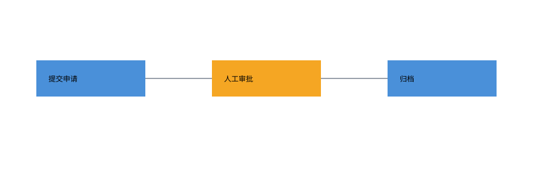

# DSH SVG Workbench

将 Phase 2 SVG 编辑器接到 DeepSeek Harness：模型通过七个结构化工具创建流程图、按 ID 修改图形、撤销/重做，并导出 SVG。每个 DSH Agent 会话有独立画布与历史，插件不读取 API key，也不直接访问用户文件。

已验证的宿主接口版本为 **DSH 0.2.2-rc.5 / Cordis 4.1.0，Node.js 24.9+**。SDK 精确版本与锁文件随源码保存。已安装的旧版 Desktop 如果使用 0.2.0-rc.1，不属于本包声明的兼容范围；请使用匹配版本的 DSH 环境。

## 构建、测试和打包

从仓库根执行：

```sh
npm ci
cd extensions/dsh-svg
npm ci
npm run check
npm test
npm run demo
npm run package
npm run verify:package
```

`npm test` 在真实官方 Cordis、ToolsService、SystemPrompt 和 Native executor 中挂载插件，使用官方 testkit 将 JSON 工具调用送入实际执行流水线。无需模型服务或 API key。14 项测试覆盖注册/卸载、参数校验、编辑/历史、失败保持状态、会话隔离、并发串行、读回、取消与资源释放。

`npm run demo` 回放 [approval-tools.json](examples/approval-tools.json) 中的 13 次调用，生成 [approval.svg](examples/approval.svg) 和完整 [tool-transcript.json](examples/tool-transcript.json)。下图是导出的文件，不是 DSH 界面截图。



打包产物为 `artifacts/dsh-svg-workbench-0.1.0.tgz`。包内已包含共享 SVG 核心、内置图形/命令和 box/tree-star 的构建结果，不依赖安装者拥有本仓库源码；DSH 服务作为 peer 由宿主提供，避免重复实例。`verify:package` 从 tgz 解压到临时目录，重新挂载官方宿主服务并执行编辑与导出，验证安装包自包含。

## 安装到匹配版本的 DSH

在已经安装 **0.2.2-rc.5** 的 `dsh` 环境中，使用绝对路径安装上一步的 tgz。选用一个独立 profile 可保留已有配置：

```sh
dsh plugin --profile svg-lab add /absolute/path/dsh-svg-workbench-0.1.0.tgz
dsh --profile svg-lab --dump-config
dsh --profile svg-lab
```

包的 `dsh.bundle.patch` 指向 `cordis.patch.yml`，该层插入 `dsh-svg-workbench`。配置输出应包含此 bundle。对于已配置 Web/模型服务的匹配版本环境，也可按其既有 profile 安装。插件本身不创建模型提供商或读取凭据。

删除：

```sh
dsh plugin --profile svg-lab remove dsh-svg-workbench
```

这些安装命令遵循固定版本的官方 bundle/profile 契约；本次实测覆盖官方宿主插件挂载、工具执行、卸载和 tgz 独立加载，**未声称已在完整 Desktop/Web 会话中完成模型对话**，也没有修改用户现有 DSH profile。

## 七个工具

| 工具 | 参数 | 作用 |
|---|---|---|
| `svg_create` | `width?`, `height?` | 初始化或替换本会话画布；成功后清空历史 |
| `svg_open` | `svg` | 从 SVG XML 文本读入；失败保留原文档，成功建立读入基准 |
| `svg_inspect` | `id?` | 查询真实树、指定节点属性、版本和历史计数 |
| `svg_edit` | `operation`, `args: string[]` | 执行一条明确编辑；成功一次为一个 undo 单元 |
| `svg_history` | `action: undo / redo` | 撤销/重做一条编辑 |
| `svg_export` | 无 | 返回 SVG XML 文本与 MIME 类型，不写盘、不建立保存屏障 |
| `svg_close` | 无 | 释放本会话画布和历史；其他会话不受影响 |

`operation` 只允许 create/delete/move/scale/set/group/ungroup/addto/front/back。参数直接交给共享 CommandProvider，**不通过 shell 或文本命令解析器**。例：

```json
{"operation":"create","args":["box","review","350","100","180","60","审批"]}
```

```json
{"operation":"set","args":["review","label","人工审批"]}
```

```json
{"operation":"move","args":["review","0","30"]}
```

创建 `in` 子句用 `[...,"in","parentId"]`；分组用 `["newGroupId","id1","id2"]`。详情与完整调用见示例 JSON。`inspect` 先查询 ID，避免模型猜测节点。工具结果的 canonical value 包含版本、树、节点属性和 undo/redo 计数；导出另有 `svg` 与 `mimeType`。期望失败由 `SvgToolError` 返回稳定错误码，例如 `SVG_EDIT_FAILED`、`SVG_SESSION_REQUIRED`、`SVG_INPUT_LIMIT`；DSH 自己处理 schema 错误与取消。

## 用户演示提示

可以在装有插件的匹配版本 DSH 会话里说：

> 用 SVG 工具创建“提交申请 → 审批 → 归档”流程图，节点用 box。先查看真实结构，把审批改成“人工审批”、改为橙色并向下移动。撤销最后一次移动。最后导出 SVG，用宿主文件工具保存为 approval.svg。

同一自然语言请求可能包含多次工具调用，撤销恢复最后一条成功编辑。导出不会抹除历史。保存文件由 DSH 已有文件工具负责；本插件返回文本，不擅自选择文件路径或写入磁盘。

## 生命周期、边界与设计原则

- 会话 ID 从受信任的 `exec.agent.id` 获取，模型不能通过参数切换他人画布。每个会话的调用按进入顺序串行执行，失败后队列可继续。
- Cordis effect 自动注销工具；`agent/disposed` 清理对应编辑器；插件卸载清理全部会话。`svg_close` 用于主动释放。内存状态跨插件重载或进程重启不保留，应先导出。
- 默认最多 100 个活动编辑器；SVG 输入最多 1,000,000 个字符；单次编辑最多 100 个参数，每项最多 10,000 字符。取消在排队前和开始执行前检查；已开始的短同步领域修改不会被中途打断。
- 支持现有 rect/circle/ellipse/line/text/g/box 子集。线段端点不会自动跟随节点；本版没有自动布局、原子批次、模式教学模板或客户端画布。
- SVG 作为文本导出，界面使用 DSH 原生 generic 工具卡片，不把导入 SVG 注入 HTML。完整图形预览是后续客户端插件扩展方向。
- Adapter 层只转换 DSH 工具协议与应用请求；Command/局部补偿沿用 CLI；box 结构知识留在插件中；两个树标签沿用可组合规则。没有为本次需求额外引入事件总线或自定义历史系统。

完整设计、复用分析、官方来源与 AI 建议检查记录见 [doc/dsh.md](../../doc/dsh.md)。源码当前随课程仓库公开，但本包尚未选择开源许可，标记为 `UNLICENSED` / `private`；已生成可安装 tgz，未上传 npm 或插件市场。
